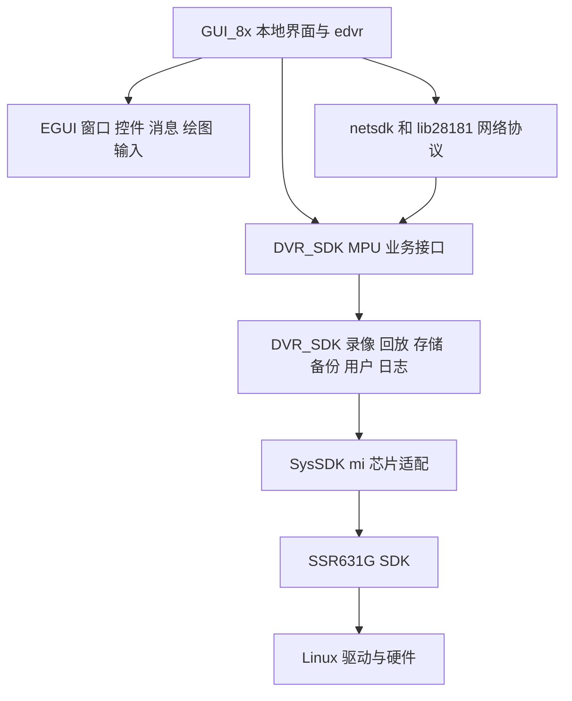

# TS3116K0 本周任务学习与分析

任务周期：2026-10-12 至 2026-10-16。整理日期：2026-10-12。

分析对象：当前 VS Code 打开的 `nvr4.6` 工作区，目标型号 `TS3116K0`。

本文依据当前源码、型号配置、构建脚本及仓库已有文档整理。已完成静态分析；未执行交叉编译、升级或实机体验。用户已补充“型号变更授权后禁止降级到不支持型号变更的旧固件”的明确需求，详见第 6.7 节。冷省、欧品其他功能差异仍待补充。

## 1. 任务与交付物

| 图片中的本周任务 | 要求交付 | 本文内容 | 当前进展 |
| --- | --- | --- | --- |
| 学习代码架构、编译打包脚本及调试方法 | 代码架构、编译打包、调试总结 | 第 2 至第 5 节 | 静态分析完成，实际操作待执行 |
| TS3116K0 支持冷省、欧品需求分析与设计 | NVR 冷省需求分析、设计文档，并覆盖欧品分析 | 第 6 节 | 已定位模块，具体差异待补充 |
| 熟悉 NVR 产品基础使用 | 产品体验报告 | 第 7 节 | 已整理操作路线和记录表，实机体验待执行 |

本周应能讲清楚：设备怎样启动，操作怎样进入代码，改动怎样变成固件，问题怎样定位。本文作为阶段性交付，后续补上真实构建和体验结果。

## 2. TS3116K0 型号基线

| 项目 | 当前配置 | 依据 |
| --- | --- | --- |
| 原始型号、硬件类型 | `TS3116K0`、`SSR631G` | [型号配置](../../model/TS3116K0Model.cfg)，第 5、6 行 |
| 编译平台 | `sstar631g` | [型号编译配置](../../menuconfig/TS3116K0.config)，第 14 行 |
| 通道规格 | `mini16`，最大 16 通道 | 配置第 19、24 行；型号配置 `ChnMax=16` |
| 交叉工具链 | `arm-sstar631-linux-` | 型号配置第 9 行；[common.mak](../../code/common.mak) 第 9 行起 |
| CPU 编译参数 | Cortex-A7、硬浮点、NEON VFPv4 | common.mak 第 114 行 |
| 芯片适配 | `code/midware/SysSDK/mi/` | [SysSDK 构建](../../code/midware/SysSDK/build)，第 24 行起 |
| 厂商 SDK、平台依赖 | `code/chipsdk/SSR631G/`、`code/libs/sstar631/` | common.mak 的 631G 分支 |
| 主程序 | `edvr` | [GUI makefile](../../code/app/GUI_8x/makefile)，第 104 行 |
| 构建、打包入口 | `build-ts3116k0.sh`、`makefs-631g.sh` | [型号构建脚本](../../build-ts3116k0.sh) |
| 当前默认软件版本 | `4.6.1.9` | [版本配置](../../model/TS3116K0Version.ini)，打包拼成四段版本 |

当前工作区未发现 `code/.config`，完整构建会复制生成它。仓库默认版本不等于样机安装版本。配置顶部的 `NVR4.5 Configuration` 是历史注释，不能替代当前字段。

当前型号配置已开启第二 IP、网络诊断、GB28181/TCP、VRS、人脸对比、2K/4K、多线程回放、动态解码码流调整、音频、看门狗、zram、TRTC/multicast、历史 RTSP 拉流。LAN switch、本地 IO 报警、异源输出、RS485 PTZ 等对应项未开启。

配置开关不等于实机能力承诺，还需核对公共 profile、宏映射、运行开关和授权。尤其“支持 4K”不代表全部通道可同时 4K 解码。

## 3. 代码架构与启动流程

### 3.1 整体架构

本项目是 C/C++ 编写的嵌入式 Linux NVR 固件。edvr 链接 GUI、业务和网络库，通过公共 API、回调和消息交互。



图表达职责和主要依赖，具体调用需沿 API 查实现。

| 目录 | 职责与阅读重点 |
| --- | --- |
| `code/app/GUI_8x/` | 业务界面，先读 gui_main.c，再按预览、回放、配置、备份查 gui_* |
| `code/midware/EGUI/` | 框架初始化、窗口、控件、消息、绘图与输入 |
| `DVR_SDK/MPU/` | GUI 和远程端使用的统一业务 API |
| DVR_SDK 其他模块 | AVL 录像、AVP 回放、STR 存储、BAK 备份、USR 用户、OPL 日志等 |
| `netsdk/`、`lib28181/` | IPC、RTSP、ONVIF、TPS、P2P、GB28181 等 |
| `SysSDK/mi/` | SigmaStar 编解码、显示、系统和算法适配 |
| `chipsdk/SSR631G/`、`libs/sstar631/` | 厂商接口与预编译依赖 |
| `code/newfs/` | 文件系统、启动、挂载与升级 |
| `code/res/` | 字体、图片和语言 |
| `menuconfig/`、`model/` | 编译能力、原始型号与版本 |

### 3.2 设备怎样启动主程序

```text
/etc/init.d/rcS
    -> S00devs、S01udev
    -> S02mount：挂载 APP、USER、SN、MODEL
    -> S[1-9][0-9]* 初始化
       -> S90modules -> /config/insmod_ko.sh
    -> /etc/init.d/rootapp
       -> 设置库路径、线程栈、共享内存等环境
       -> 尝试挂载硬盘并配置 core
       -> 启动 /usr/lib/watch 和 /usr/lib/edvr
```

依据：[rcS](../../code/newfs/fs1_631g/etc/init.d/rcS)、[S02mount](../../code/newfs/fs1_631g/etc/init.d/S02mount)、[rootapp](../../code/newfs/fs1_631g/etc/init.d/rootapp)。硬盘挂载成功且存在 `/usr/local/etc/coredebug.sh` 时会走特殊调试脚本，需看设备实际内容。

| 内容 | 打包准备位置 | 设备位置 |
| --- | --- | --- |
| 主程序、应用库 | `rootfs/newfs/app/lib/` | `/usr/lib/` |
| GUI 字体、图片和资源 | `rootfs/newfs/app/edvr/` | `/root/edvr/` |
| 原始型号 | `rootfs/newfs/fs1_631g/root/DvrModel.cfg` | `/root/DvrModel.cfg` |
| 用户配置 | USER 文件系统 | `/usr/local/etc/` |
| AI 模型 | MODEL 文件系统 | `/model/` |

### 3.3 当前选中的 EGUIMain

[EGUI main.c](../../code/midware/EGUI/src/main/main.c) 第 43 行是声明，第 73 行是调用；实现位于 [gui_main.c](../../code/app/GUI_8x/gui_main.c) 第 9305 行。

```text
程序入口引用 main
    -> -Wl,--wrap,main
    -> gui_main.c::__wrap_main()       第 8142 行
    -> EGUI main.c::my_ecos_main()     第 54 行
       -> InitEGUI()                  框架初始化
       -> gui_main.c::EGUIMain()      业务初始化和主消息循环
       -> TerminateEGUI()             框架清理
```

`__real_main()` 的调用被注释。my_ecos_main 是历史函数名，不能据此推断设备运行 eCos。链接参数见 GUI makefile 第 53 行。

### 3.4 框架、业务和窗口消息

| 函数 | 职责 |
| --- | --- |
| `InitEGUI()` | 框架图形、屏幕 DC、窗口元素、菜单和控件；[init.c](../../code/midware/EGUI/src/kernel/init.c) 第 730 行 |
| `InitGui()` | NVR 应用资源、语言、扩展控件与状态；gui_main.c 第 1693 行 |
| `MPU_Init()` | NVR 业务模块初始化；EGUIMain 中第 9429 行调用 |
| `CreateGuiDesktop()` | 创建业务窗口、绑定 DeskWinProc；第 7860 行 |

EGUIMain 阅读顺序：zram/信号处理 -> InitGui -> 设备能力/音量/显示 -> 设置语言 -> 业务桌面/启动窗 -> 注册 IPC 和远程回调 -> MPU_Init -> 完成其他初始化 -> 主消息循环 -> 业务与 GUI 清理。

```text
输入/业务通知 -> 消息队列
    -> GetMessage -> TranslateMessage -> DispatchMessage
    -> 窗口过程 DeskWinProc / StartWinProc
    -> 更新页面或调用 MPU_* API
```

`TransMsg()` 在第 1591 行，CreateStartWnd 的宿主为 HWND_DESKTOP 时于第 1647 行创建启动窗消息线程。EGUIMain 最终主循环在第 9628 行，处理 `g_tGuiWnd.hDeskWnd`。

HWND_DESKTOP 是框架桌面，hDeskWnd 是应用业务窗口，两者要区分。窗口对象创建见 [window.c](../../code/midware/EGUI/src/gui/window.c) 第 3710 行，消息队列与分发见 [message.c](../../code/midware/EGUI/src/kernel/message.c)。界面卡顿可查窗口过程的耗时操作和后台通知路径。

## 4. 编译与打包总结

### 4.1 环境与完整构建

在已配置工具链的 Linux/WSL 或团队构建服务器操作，当前 Windows 工作区用于阅读，本文未执行构建。

```sh
command -v arm-sstar631-linux-gcc
arm-sstar631-linux-gcc --version
arm-sstar631-linux-gcc -print-sysroot
command -v make
command -v bash
command -v python3
command -v sha256sum
```

common.mak 查询编译器 sysroot；[EGUI 631G 配置脚本](../../code/midware/EGUI/buildlib-linux-arm-sstar631g) 第 5 行还写有 `/opt/mstar-linux/...gcc-12.4.0-glibc-2.37-gnueabihf/.../sysroot`，两处环境需一致。

部分脚本声明 `#!/bin/sh`，但使用 pushd/popd、`[[ ... ]]` 等语法，应使用团队已验证的 shell 环境。在 `/bin/sh` 为 dash 的环境不能只凭 shebang 认定可运行。

在仓库根目录完整构建：

```sh
./build-ts3116k0.sh def all upg
```

| 参数 | 作用 |
| --- | --- |
| def | 使用 TS3116K0Version.ini 当前版本，当前拼为 4.6.1.9 |
| all | 第二参数传给打包，再传给恢复/母片流程；不是选择 make all 的开关 |
| upg | 额外第二次打包，输出到 Upgrade 型号目录 |

脚本每次都清理并完整编译，打包重建临时目录并更新版本 ini 的 BuildDate，执行前保存工作区状态。

### 4.2 编译调用链

```text
build-ts3116k0.sh
    -> 清空 build.txt，准备 tmp
    -> 复制 TS3116K0.config 到 code/.config
    -> make -C code clean
    -> make -C code
       -> common.mak：工具链、平台和能力宏
       -> tps_protocol / ipcuc / sn / zram / signalhandle / base
       -> DVR_SDK 业务库
       -> modules / lib28181 / SysSDK / netsdk
       -> EGUI：CrossConfigure -> 631G configure -> 编译
       -> GUI_8x：链接 edvr、edvr_debug
       -> upgrading-ms621 升级程序
    -> makefs-631g.sh ts3116k0 def all
    -> 指定 upg 时，再执行一次带 upg 的打包
```

依据：[code/Makefile](../../code/Makefile) 第 14 行和各目标实现。这是当前目标文本顺序，不是已声明完整依赖的并行构建图，首次验证沿用现有脚本。

| 编译产物 | 位置 |
| --- | --- |
| 业务库，如 libMPU.so | code/midware/DVR_SDK/lib_sstar631g/ |
| 芯片适配库 | code/midware/SysSDK/mi/libhisdk.so，再安装到平台库目录 |
| GUI 发布程序 | code/app/GUI_8x/edvr，发布对象文件在 RELEASE/ |
| GUI 调试程序 | code/app/GUI_8x/edvr_debug，调试对象文件在 DEBUG/ |
| 链接映射 | code/app/GUI_8x/edvr.map |
| 构建日志 | 根目录 build.txt |

### 4.3 文件系统与固件打包

[makefs-631g.sh](../../makefs-631g.sh) 的主要流程：

1. 创建 rootfs，复制 code/newfs、升级模板和 GUI 图片。
2. 更新构建时间，复制版本、型号、字体、模型注册配置。
3. 复制 edvr、业务库、平台依赖、升级与校验工具。
4. 调用 rootfs/newfs/buildfs_631g.sh ts3116k0 生成文件系统。
5. 生成恢复包、普通更新包、语言包，第一轮还处理母片打包。
6. 复制版本产物到型号输出目录。

[buildfs_631g.sh](../../code/newfs/buildfs_631g.sh) 使用基础 rootfs 压缩包和 631G 覆盖文件。当前卷参数：

| 内容 | 卷大小参数 | 用途 |
| --- | --- | --- |
| ROOTFS | 14M | Linux 用户空间和基础文件 |
| APP | 18M | 程序、应用库和资源 |
| USER | 18M | 可写配置 |
| SN | 8M | SN 相关内容 |
| MODEL | 132M | DET/FR/RET 等 AI 模型 |

以上是文件系统生成参数，不等于物理分区容量。物理布局还需查母片脚本和设备 `/proc/mtd`。

普通更新流程从 release 复制 ROOTFS、APP，并整理目标型号后缀文件；不能认为普通更新会重置 USER、SN 或覆盖全部 MODEL。实际内容需查包内文件和升级路径。

### 4.4 产物的区分

| 输出 | 用途 |
| --- | --- |
| tmp/TS3116K0/ | 第一轮版本产物 |
| tmp/Upgrade/TS3116K0/ | 指定 upg 后第二轮产物 |
| update-ts3116k0-v<版本>-build<时间>.bin | 普通更新包，压缩内容后追加校验信息 |
| restore-ts3116k0-v<版本>-build<时间>.bin | 恢复类产物，内容与操作按现有工具确认 |
| 母片和分区镜像 | 生产/烧录，与普通更新区分 |
| Language/ | 界面语言包 |
| 中英文模型包 | 独立 AI 资源，检查软件最低版本和索引兼容性 |
| edvr.bin | gzip tar 诊断归档，含程序、库、map、清单；不是固件 |

第二轮 upg 的构建时间按脚本加 5 分钟，版本相同也可能有不同 BuildDate。固件、诊断包和日志按同一轮归档。

### 4.5 验证与局部构建

保存命令、退出码、工具链、日志、产物清单、版本和校验值：

```sh
./build-ts3116k0.sh def all upg
build_rc=$?
printf 'build exit code: %s\n' "$build_rc"
rg -n 'error:|undefined reference|No such file|Permission denied|failed' build.txt
find tmp/TS3116K0 tmp/Upgrade/TS3116K0 -maxdepth 2 -type f
tar tzf tmp/TS3116K0/edvr.bin
```

run_logged 保存主要子命令退出码，内部打包仍有独立错误路径。成功横幅要结合日志、产物完整性和设备运行结果。

配置与依赖准备后可局部编译：

```sh
make -C code guiapp
make -C code dvrsdk
make -C code egui
make -C code netsdk
make -C code syssdk
make -C code up
```

局部目标也可能清理产物，例如 dvrsdk 删除平台库并调用模块构建。改库后还要核对主程序链接、打包和设备运行时库一致性。

## 5. TS3116K0 调试方法

### 5.1 按现象定位

| 现象 | 优先排查 |
| --- | --- |
| 开机无界面 | 串口、S02mount、驱动、动态库、InitEGUI |
| 卡启动进度 | EGUIMain、MPU_Init、硬盘/IPC/模型初始化、启动通知 |
| 菜单正常但无视频 | IPC、协议、FIU、码流、解码和显示 |
| 预览正常但无录像 | 硬盘、计划、时间、AVL 和 STR |
| 有录像但不能回放 | 条件、索引、AVP、解码资源 |
| 本地/远程型号不一致 | 公共来源、设备能力缓存、接口路径 |
| 授权后型号未变 | 原始型号、功能码、解码、缓存、重启 |
| 更新被拒绝 | 升级身份、版本门槛、校验 |
| 崩溃/自动重启 | stack/maps/core、看门狗、内存与线程 |

具备设备 shell 接入条件时先采集只读信息：

```sh
uname -a
cat /root/DvrModel.cfg
cat /root/edvr/DeviceVersion.ini
cat /proc/mtd
mount
ps
free
dmesg
```

记录 SN、板型、安装版本、IPC 型号与固件、网络、硬盘、授权、复现步骤。本文不假设设备已启用 SSH 或固定账号。

### 5.2 崩溃证据

[hanld_signal.cpp](../../code/midware/signalhandle/hanld_signal.cpp) 当前使用：

- `/dat/sda0/stack.txt` 保存崩溃报告，失败时尝试 `/dat/stack.txt`。
- 硬盘已挂载时保存 `/dat/sda0/maps.txt`，无硬盘时跳过。
- stack/maps 按同次时间对应，maps 覆盖保存，应及时归档。
- SIGSEGV 末尾恢复默认行为并重新触发，core 取决于限制、配置和存储。

rootapp 启动 edvr 前设置过 `ulimit -c 1024`，末尾再设 unlimited；后者不会改变已启动进程继承的限制。检查 `/proc/<pid>/limits` 和 `/proc/sys/kernel/core_pattern`，不能默认有完整 core。

### 5.3 地址定位

1. 取得故障固件同次构建的 edvr.bin 并解压。
2. 保存同次 stack、maps、串口和复现条件。
3. 使用 frame/PC 在 maps 中确定 ELF 模块。
4. 共享库或 PIE 换算加载偏移，非 PIE 主程序通常使用原代码地址。
5. 用对应 ELF 和 631G 工具解析。

```sh
tar zxf edvr.bin
arm-sstar631-linux-readelf -h debug_symbols/app/edvr
arm-sstar631-linux-readelf -lW debug_symbols/app/lib/libMPU.so
arm-sstar631-linux-addr2line -f -C -e debug_symbols/app/edvr <代码地址>
arm-sstar631-linux-addr2line -f -C -e debug_symbols/app/lib/libMPU.so <ELF地址>
```

尖括号是占位符，执行时替换。si_addr 通常是非法访问目标，不能代替 PC。

例如共享库映射起点 0xb6645000、文件偏移 0，frame 为 0xb667ea30，且对应 ELF 段虚拟地址从 0 起，则解析地址为 0x39a30。一般要结合 PT_LOAD 求 load_bias，再用 PC-load_bias；不能对所有 ELF 都套用“PC-映射起点+文件偏移”。Thumb 低位和返回地址需结合反汇编。

### 5.4 符号限制与 GDB

| 位置 | 当前行为 | 影响 |
| --- | --- | --- |
| GUI makefile 第 101、102 行 | 调试 -g，发布 -Os 通常无 -g | 发布 edvr 不保证源码行信息 |
| DVR_SDK/common.mak 第 15、18 行 | 发布 -O3 -DNDEBUG，调试 -g | 业务发布库可能无源码行信息 |
| SysSDK/mi/makefile 第 77 行 | 链接后直接 strip | 打包无法恢复丢失符号 |
| buildfs 第 145、151、185 行附近 | 文件系统 strip 前复制归档 | 只保存此时仍存在的符号 |

需要行级定位，为实际运行的同套二进制保留调试信息和未 strip ELF。不能拿另一次构建的 edvr_debug 解析当前发布程序。

[stack_debug.md](../../stack_debug.md) 中的示例工具为 621Q，本型号改用 arm-sstar631-linux-*；其 GDB 示例有重复 debug_symbols 路径，按实际解压目录执行。

```sh
arm-sstar631-linux-gdb debug_symbols/app/edvr <core文件>
```

```gdb
set sysroot debug_symbols/rootfs
set solib-search-path debug_symbols/app/lib:debug_symbols/rootfs/lib:debug_symbols/rootfs/usr/lib
info sharedlibrary
thread apply all bt full
info registers
```

现场 gdbserver 需要设备服务、主机工具与网络，并考虑暂停对录像和看门狗的影响。本文未配置或执行远程调试。

## 6. 冷省、欧品需求分析与设计

### 6.1 资料范围

用户已确认独立需求资料后续补充。已有 [TS3116K0型号变更说明.md](TS3116K0型号变更说明.md) 是村品改市品方案，明确冷省先不处理，县品/欧品新增转换后续处理。不能按“冷省”名称推断温控或低温指标，也不能把欧品等同于英文界面。

以下引用已有方案，正式型号和能力还需确认：

| 品类 | 已有文档中的场景 | 命名示例 | 当前状态 |
| --- | --- | --- | --- |
| 村品 | 华北 10 省农村、热省农村种养殖 | TS3116K0 | 当前原始型号 |
| 市品 | 华北 10 省城市、热省精装 | TS2116K0 | 源码已有 TS3 通过码 33 改 TS2 |
| 县品 | 华南 22 省县区、冷省县城精装 | TS3116K05 | 仅命名示例，差异待补充 |
| 欧品 | 欧洲县区、欧洲县区精装 | TS3116K07 | 仅命名示例，差异待补充 |

冷省是市场场景，县品是品类，资料不能证明它们一一对应。后续确认冷省最终使用哪种品类和交付方式。

### 6.2 当前源码与市品方案差异

[MPU_PUB_API.cpp](../../code/midware/DVR_SDK/MPU/MPU_PUB_API.cpp) 第 333 行 `MpuPubResolveModelNames()` 的当前行为：

| 原始型号与有效授权 | 当前显示型号 | 当前升级匹配型号 |
| --- | --- | --- |
| TS3116K0，无型号变更码 | TS3116K0 | TS3116K0 |
| TS3116K0，码 27 | TS3116K0 | TS3116K0 |
| TS3116K0，码 33 | TS2116K0 | TS3116K0 |
| TS8 前缀，码 27 | 第三字符从 8 改 7 | 同时改成对应 TS7 型号 |

[EncInterface.h](../../code/midware/tps_encrypt/EncInterface.h) 第 61、64 行定义码 27 和码 33。已有文档提出“TS3116K0 临时用码 27 转市品”，当前源码尚未加入条件；该方案也不代表冷省/欧品需求。

[CBaseUpdate.cpp](../../code/midware/DVR_SDK/SYS/CBaseUpdate.cpp) 第 72、882 行附近对 631G 持有码 33 的设备检查最低升级版本 `4.6.1.8`。用户现已明确要求：型号变更授权成功后禁止降级到不支持该转换的版本。该保护也需覆盖 TS3116K0 的临时码 27，具体分析见第 6.7 节。

### 6.3 型号和授权链路

```text
/root/DvrModel.cfg 原始型号
    -> MPU_PUB_GetTypeName
       -> 加载、解码已有授权
       -> MpuPubResolveModelNames
          -> display_model：界面和设备信息
          -> upgrade_model：升级匹配
    -> MPU_PUB_GetDeviceCap -> 本地系统信息/公共远程接口
```

| 模块 | 已定位内容 | 后续影响 |
| --- | --- | --- |
| MPU/MPU_PUB_API.cpp | 型号、授权集合、两类型号映射与缓存 | 品类显示、公共接口一致性 |
| sn/operatemtd.c | save_funccode_to_flash、load_funccode_from_flash | 授权持久化与升级保留 |
| netsdk/TPS/src/uc2/uc2syscontrol.cpp | 型号码互斥、631G 支持码列表 | 新码支持、冲突和上报 |
| GUI_8x/gui_config_sysinfo_basic.c | 公共设备能力中的型号 | 本地验收 |
| MPU/MPU_CIU_Config_Dev.cpp | 对外设备/系统信息 | 远程验收 |
| GUI_8x/gui_firmware_check.c | MPU_PUB_GetUpgradeTypeName | 升级身份 |
| SYS/CBaseUpdate.cpp | 软件版本限制 | 更新与降级规则 |
| S02mount、631G 升级脚本 | 直接匹配原始 ts3116k0 | 改原始型号影响模型挂载与升级 |

型号和设备描述有缓存，初步按“授权后重启读取”验收。即时生效需设计缓存刷新，覆盖 GUI、设备能力与远程接口。

### 6.4 待补充需求表

| 编号 | 需要明确的事项 | 冷省 | 欧品 | 应形成的结果 |
| --- | --- | --- | --- | --- |
| R01 | 市场、场景、正式品类和型号 | 待补充 | 待补充 | 产品定义和型号矩阵 |
| R02 | 与 TS3116K0 的功能差异：保留、增加、关闭 | 待补充 | 待补充 | 差异表及可观察结果 |
| R03 | 板型、通道、硬盘、解码规格 | 待补充 | 待补充 | 硬件能力和性能指标 |
| R04 | 授权转换或独立固件、正式码和互斥 | 待补充 | 待补充 | 授权状态转换表 |
| R05 | 出厂默认、老配置迁移、恢复出厂 | 待补充 | 待补充 | 默认值与迁移规则 |
| R06 | 语言、时区、DST、NTP、日期格式 | 待补充 | 待补充 | 本地化和时间边界测试 |
| R07 | AI 检索语言、模型、旧索引兼容 | 待补充 | 待补充 | 模型/索引兼容矩阵 |
| R08 | 协议、云服务、客户端、网络策略 | 待补充 | 待补充 | 服务兼容矩阵 |
| R09 | 升级身份、最低版本、降级规则 | 型号授权后禁止降到不支持转换的旧固件已明确；其他差异待补充 | 同左，欧品专属规则待补充 | 固件升级路径，第 6.7 节 |
| R10 | GUI、远程 API、权限的限制与提示 | 待补充 | 待补充 | 统一能力规则 |
| R11 | 样机、版本、指标和验收负责人 | 待补充 | 待补充 | 可执行验收计划 |

每项补齐来源、目标行为、现状、差异、修改模块、验收方法、负责人和确认日期。

### 6.5 设计建议

1. **区分原始型号、显示品类与业务能力。** 改显示字符串不会自动改变功能。
2. **统一公共结果。** 型号由 MPU 输出，本地/远程取相同结果；功能限制落到业务 API，GUI 使用一致能力结果。
3. **按差异选择固件策略。** 同板型且可用配置/授权表达时评估共用固件，硬件/编译依赖不同再设计独立型号入口。
4. **定义授权状态转换。** 出厂、未授权、成功、失败、重启、升级、恢复、降级逐项规定，新码同步核对枚举、支持列表、持久化、互斥。
5. **明确升级身份。** 共用固件时评估保留 TS3116K0 原始身份；新原始型号需同步处理启动、挂载、固件和模型包识别。
6. **设计默认配置迁移。** 出厂默认与用户已有设置分开规定，不因升级覆盖已有配置。
7. **限定转换范围和字段长度。** 使用明确型号和条件，检查县品/欧品追加字符后的缓冲区和协议长度。
8. **固件和模型一起验收。** 软件最低版本、模型语言、索引兼容独立检查，界面语言变化不代表 AI 语言已切换。

当前已有中英文 RET 模型。manifest 有 `Product=TS3116K0`、`MinSoftwareVersion=4.6.1.7`、索引兼容标识；buildfs 生成中英文模型包，默认模型目录使用中文。欧品若需英文检索可沿这些入口分析，默认安装、模型切换、旧索引和识别效果仍需确认。

依据：[模型 manifest](../../code/newfs/algmodel/sstar631/manifest.ini)、[模型包生成器](../../code/newfs/algmodel/sstar631/build_model_package.py)、[模型组注册](../../code/newfs/app/edvr/model_group_registry.ini)、[MPU_Model_API.cpp](../../code/midware/DVR_SDK/MPU/MPU_Model_API.cpp)、[模型升级页](../../code/app/GUI_8x/gui_config_device_model_upgrade.c)。

### 6.6 验收草案

| 场景 | 必须检查 | 预期依据 |
| --- | --- | --- |
| 出厂无授权 | 型号、默认语言、网络、功能 | R01/R02/R05/R06 |
| 冷省/欧品授权并重启 | 本地/远程型号、能力、持久化 | R01/R02/R04 |
| 无效/冲突授权 | 错误提示、原状态保留 | R04，不能部分转换 |
| 老设备升级 | 配置、授权、录像、索引 | R05/R07/R09 |
| 恢复出厂再重启 | 配置与授权分别按规则处理 | R04/R05，不能默认清授权 |
| 更新/降级拒绝 | 正确拒绝、原系统可用 | R09 |
| 语言、时区、DST | 显示、日志、录像检索时间 | R06 |
| 中英文模型更新 | 包兼容、语言、旧索引 | R07 |
| GUI/远程执行相同功能 | 一致限制与错误行为 | R02/R10 |
| 预览、录像、回放、检索组合 | 性能、稳定性、资源 | R03 正式指标 |

### 6.7 已确认需求：授权后禁止降级至不支持型号变更的固件

#### 6.7.1 用户提供的复现和期望

| 项目 | 截图中的内容 |
| --- | --- |
| 当前版本 | `V4.6.1.8_10`，按截图原样记录 |
| 步骤 1 | 授权市品型号变更码，产品型号由 TS3116K0 变为 TS2116K0 |
| 步骤 2 | 降级到不支持型号变更的版本 |
| 实际结果 | 可以降级，产品型号变回 TS3116K0 |
| 期望 | 型号变更码授权成功后，不能升级回不支持该转换的旧版本 |

这是一条明确的固件兼容性要求。禁止目标是不支持已授权型号转换的固件；截图没有要求禁止所有低版本固件。仍支持该转换的版本是否允许安装，继续按已有版本、板型及校验规则判断。

截图没有提供实际功能码、目标旧包版本、升级入口及日志，不能仅凭图片认定唯一根因，也不能把显示型号回退直接解释为授权被清除。旧固件可能保留授权数据但不识别 TS3116K0 的转换规则。

#### 6.7.2 为什么原始升级型号仍需保留

显示型号 TS2116K0 与升级身份 TS3116K0 分开是现有设计。它允许设备继续使用同一硬件平台的更新包，但也意味着旧 TS3116K0 包可能通过型号匹配。因此必须增加或确认业务版本兼容检查，不能只靠替换升级型号阻止旧包。

期望流程：

```text
读取设备原始身份与有效授权
    -> 读取目标包的真实版本信息
    -> 检查是否支持当前授权型号转换
       -> 不支持：返回版本不兼容错误，终止刷写
       -> 支持：继续现有板型、版本、完整性校验
```

禁止路径不得清授权、改回型号或写入旧固件。即使授权后尚未重启、显示缓存还没刷新，也应读取已有有效授权并立即限制旧包。

#### 6.7.3 当前源码的检查点与风险

| 位置 | 当前行为 | 与本需求的关系 |
| --- | --- | --- |
| CBaseUpdate.cpp 第 72、883 行 | 码 33 使用数值四段比较，目标低于 4.6.1.8 或比较失败则返回版本错误 | 当前工作区已存在该保护，但不能证明 V4.6.1.8_10 实机产物已包含或执行 |
| 同文件第 897 行 | 包内 EnableCheck 不为 YES 时可提前返回成功 | 强制授权兼容保护必须在该分支之前执行 |
| 同文件第 971 行 | 码 27 只检查 4.6.1.3 门槛，且使用 strcmp | 与 TS3116K0 市品边界不同；不阻止 4.6.1.3 至 4.6.1.7 的不兼容包 |
| 同文件第 971 行 | 四段版本按字符串比较 | 4.6.1.10 会被误认为低于 4.6.1.3，需避免旧检查影响新规则 |
| MPU_PUB_API.cpp 第 234、260 行 | MPU_PUB_HasFuncCode 重新解码两个授权槽 | 适合查询码 27/33，不能只按显示缓存判断 |
| MPU_PUB_API.cpp 第 199、308 行 | 型号映射集合及旧 IsExistModelChangeCode 仅读授权槽 0 | 验证授权保存槽位与映射/版本保护是否一致 |

需要区分两种现场情况：

- 若使用临时码 27：现有码 33 的 4.6.1.8 保护不会执行，旧码 27 门槛可能放行不兼容包。
- 若使用码 33：当前源码按预期应拒绝低于 4.6.1.8 的正常版本包，应查安装产物、包内版本字段、授权解码、入口是否经过 check_version。

#### 6.7.4 建议修改范围

| 文件/入口 | 设计内容 |
| --- | --- |
| MPU/MPU_PUB_API.cpp::MpuPubResolveModelNames | 按已有方案加入 TS3116K0 临时码 27 的显示转换，保留升级身份 |
| SYS/CBaseUpdate.cpp::check_version | 统一 TS3116K0 码 27/33 的兼容版本保护，使用已有 ParseDottedVersion/CompareDottedVersion |
| 同文件旧 4.6.1.3 条件 | 避免它再对已走新规则的 TS3116K0 使用 strcmp；其他型号原规则另行保留 |
| GUI/TPS 升级调用方 | 验证版本错误不会转成“确认后继续降级”，失败后不执行更新脚本 |
| 固件打包版本文件 | 核对包内 tmp/version 的目标软件字段，不能只看文件名或界面版本 |

条件建议：原有码 33 保护保留；临时码 27 保护限定原始/升级身份为 TS3116K0，避免把码 27 在其他型号上的含义整体改掉。身份读取失败时，本次兼容检查不能默认放行。

版本保护应返回 `IDVR_SYS_UPDATE_ERROR_VERSION` 并走现有错误出口；不能返回 `IDVR_SYS_UPDATE_PREVIOUS_VERSION`。后者是普通降级提示，本地流程会调用确认回调，文件复制后也可能将它视为可继续的结果。

当前本地路径在 CBaseUpdate.cpp 第 1261 行预检、第 1425 行复制后复检；远程 UpdateFromFileRemote 在第 1191 行检查；CUpdateManager::CheckVersion 第 134 行也转入 check_version。需要分别验证调用方收到失败后停止更新。

`4.6.1.8` 是当前源码使用的候选最低边界，截图中的 `_10` 尚未说明含义。若同为 4.6.1.8 的其他构建仍不支持转换，只比较四段数字不能区分，需用实际发布记录确定支持范围，并补充可验证的构建标识/能力信息。不能直接宣布所有 4.6.1.8 包均满足要求。

#### 6.7.5 验收用例

| 编号 | 条件与操作 | 预期 |
| --- | --- | --- |
| MC-D01 | 有效码 33，尝试已确认不兼容的旧包 | 刷写前拒绝，型号仍为 TS2116K0，授权保留 |
| MC-D02 | TS3116K0 临时码 27，尝试同一旧包 | 与 MC-D01 相同 |
| MC-D03 | 授权成功后尚未重启，尝试不兼容包 | 立即按有效授权拒绝，不依赖显示缓存 |
| MC-D04 | 不兼容包 EnableCheck 非 YES | 仍拒绝，强制规则不能被跳过 |
| MC-D05 | 目标分别为 4.6.1.3、4.6.1.7 | 确认为不支持转换时拒绝，覆盖旧码 27 检查的缺口 |
| MC-D06 | 已确认支持的边界版本及不同构建 | 兼容保护通过，继续其他校验，不保证无条件安装 |
| MC-D07 | 已确认支持的 4.6.1.10 等多位版本 | 数值比较正确，不能被旧 strcmp 误拒绝 |
| MC-D08 | 未授权设备尝试旧包 | 由原有升级规则判断，不新增市品授权限制 |
| MC-D09 | 本地、远程升级各复现一次 | 均拒绝，不调用刷写脚本、不主动重启、不清授权 |
| MC-D10 | 拒绝后手动重启 | 版本未变，授权有效，仍显示 TS2116K0 |

本需求落实于包含修复的运行固件。恢复包、U-Boot、生产烧录等绕开 edvr 的入口需单独审查；只改 check_version 不能声称已覆盖所有刷写方式。本文未修改业务源码或实机复现。

排查归档：当前完整版本/BuildDate、libSYS.so 对应构建、授权码及槽位、旧包真实版本、入口、check_version 返回值、是否执行刷写、重启后型号。该问题纳入第 7 节产品体验报告。

## 7. NVR 基础使用与体验报告

### 7.1 实机准备与操作路线

准备 TS3116K0、显示器、鼠标、电源、交换机、IPC、测试盘和 U 盘，端口按样机确认。先记录版本和型号。以下是源码对应的待执行路线，菜单名称以实机版本为准，不能预填结论。

格式化、恢复出厂和刷写改变设备状态，应使用已确认的测试设备和数据。

| 顺序 | 操作 | 观察与记录 | GUI 代码入口 |
| --- | --- | --- | --- |
| 1 | 开机 | 耗时、进度、分辨率、鼠标 | gui_main.c、gui_config_board_guide.c |
| 2 | 登录、系统信息 | 权限、型号、SN、安装版本 | gui_login.c、gui_config_sysinfo_basic.c |
| 3 | 网络和时间 | IP、网关、IPC 可达性、NTP | gui_config_system_network.c、gui_config_system_primary_timeset.c |
| 4 | 搜索、添加 IPC | 列表、协议、凭据、结果、离线提示 | gui_source_device_manage.c、gui_remote_device_login.c |
| 5 | 预览 | 多画面、全屏、主辅码流、音频、断流恢复 | gui_preview.c、gui_main_toolbar.c |
| 6 | 硬盘 | 识别、容量、健康、录像空间 | gui_config_device_storage.c、gui_newdisk_init.c |
| 7 | 录像计划 | 通道、时间段、保存后实际录像 | gui_config_record_plan.c |
| 8 | 本地回放 | 日期、通道、时间轴、暂停、速度、无录像提示 | gui_playback.c |
| 9 | 备份录像 | 时段、介质、进度、取消、导出文件可用性 | gui_backup.c |
| 10 | 日志与诊断 | 登录/配置/故障日志、IPC 网络 | gui_config_sysinfo_log.c、gui_network_diagnosis_main.c |
| 11 | 语言、智能检索 | 文本输入、模型状态、结果 | language.c、gui_config_commonbase_language_set.c、gui_insight_text_search.c |
| 12 | 测试机升级/重启 | 校验、版本、配置/授权保留、录像恢复 | gui_config_device_system_update.c、gui_firmware_check.c |

### 7.2 操作到业务 API

| 操作 | 已查到的 API | 后续方向 |
| --- | --- | --- |
| IPC 搜索 | MPU_FIU_ProbeDeviceSetCB、MPU_FIU_ProbeDeviceStart | FIU、回调更新列表 |
| 录像计划 | MPU_AVL_Record_GetSchedule、MPU_AVL_Record_SetSchedule | AVL 调度和保存 |
| 硬盘 | MPU_STR_Disk_GetNum、MPU_STR_DiskGroup_GetInfo | STR 状态通知 |
| 备份 | MPU_BAK_CreateManager、MPU_BAK_Start、MPU_BAK_Stop | 任务、进度、取消 |
| 回放 | MPU_AVP_* | 播放器和解码 |
| 型号 | MPU_PUB_GetDeviceCap | 型号映射和缓存 |

建议本周完成添加 IPC、保存录像计划、查看型号三条短链路，从事件到 MPU、业务实现和回调更新。

### 7.3 体验报告填写表

| 项目 | 待填写 |
| --- | --- |
| 日期与人员 | 待实机填写 |
| 型号、SN、板型 | 待实机填写 |
| 安装版本/BuildDate | 待实机填写，不能以仓库版本代替 |
| 显示型号、授权 | 待实机填写 |
| IPC 数量、型号、协议、固件 | 待实机填写 |
| 网络、硬盘、U 盘 | 待实机填写 |
| 完成操作与结果 | 按第 7.1 节记录 |
| 启动/搜索/添加/切换耗时 | 测量值和条件 |
| 易理解的页面和提示 | 具体操作与观察 |
| 卡顿、困惑、失败、不一致 | 可复现步骤、实际结果 |
| 证据 | 截图、串口/应用日志、导出文件、录像时段 |
| 建议 | 问题、影响、建议模块 |

问题记录：

| 编号 | 场景 | 前置条件与步骤 | 预期 | 实际 | 证据 | 代码定位 | 状态 |
| --- | --- | --- | --- | --- | --- | --- | --- |
| P01 | 市品授权后降级 | 用户在 V4.6.1.8_10 授权后安装不支持转换的旧固件 | 拒绝旧包，型号和授权保留 | 用户报告降级成功并恢复 TS3116K0 | 用户截图；日志/包版本待补充 | SYS/check_version、授权读取 | 需求已确认；源码分析完成，修复与实机待执行 |

## 8. 五天安排

| 日期 | 重点 | 当日成果 |
| --- | --- | --- |
| 10-12，周一 | 目录、型号、框架与业务入口 | 架构、启动链、能力表 |
| 10-13，周二 | 完整编译打包 | 命令、日志、退出码、工具链、产物 |
| 10-14，周三 | 故障样例或调试演练 | 复现、maps/ELF 换算、定位结论 |
| 10-15，周四 | 冷省/欧品需求设计评审 | R01-R11 确认情况、差异、影响、验收 |
| 10-16，周五 | 产品操作体验和总结 | 体验报告、问题、编译调试总结、下周待办 |

根据环境、样机和资料到位情况调整，未执行项目保持真实状态。

## 9. 阶段总结与待办

已完成型号、架构、入口、窗口消息、编译打包、调试方法的静态分析；区分码 33 已有市品转换与码 27 待应用方案，整理冷省/欧品设计框架和产品体验路线。根据新截图补充授权后禁止不兼容降级的明确需求、源码检查点、设计与验收用例。

- [ ] 正式环境完成编译打包并归档日志、产物。
- [ ] 实机核对版本、启动、IPC、录像、回放、备份。
- [ ] 故障分析或演练，核对符号与运行二进制。
- [ ] 补冷省/欧品功能、型号、授权、默认值、升级规则。
- [ ] 落实并验证第 6.7 节授权后禁止不兼容降级，核对实际支持版本及构建边界。
- [ ] 实测授权、更新、重启、配置保留。
- [ ] 完成体验报告、问题清单、最终周报。

## 10. 阅读索引

行号依据整理时工作区，后续按函数名重新定位。

| 文件 | 关键词 |
| --- | --- |
| [型号配置](../../menuconfig/TS3116K0.config) | sstar631g、mini16、CONFIG_* |
| [构建脚本](../../build-ts3116k0.sh) | run_logged、配置、clean/make、两次打包 |
| [总 Makefile](../../code/Makefile)、[common.mak](../../code/common.mak) | 目标、工具链、宏 |
| [gui_main.c](../../code/app/GUI_8x/gui_main.c) | __wrap_main、InitGui、EGUIMain、DeskWinProc |
| [EGUI main.c](../../code/midware/EGUI/src/main/main.c) | my_ecos_main、InitEGUI、EGUIMain 调用 |
| [window.c](../../code/midware/EGUI/src/gui/window.c)、[message.c](../../code/midware/EGUI/src/kernel/message.c) | 窗口、队列、分发 |
| [GUI makefile](../../code/app/GUI_8x/makefile) | wrap、发布/调试、链接 |
| [makefs](../../makefs-631g.sh)、[buildfs](../../code/newfs/buildfs_631g.sh) | 资源、版本、文件系统、strip、edvr.bin |
| [MPU_PUB_API.cpp](../../code/midware/DVR_SDK/MPU/MPU_PUB_API.cpp) | 型号、授权、能力、缓存 |
| [uc2syscontrol.cpp](../../code/midware/netsdk/TPS/src/uc2/uc2syscontrol.cpp)、[CBaseUpdate.cpp](../../code/midware/DVR_SDK/SYS/CBaseUpdate.cpp) | 授权、互斥、升级版本 |
| [型号变更方案](TS3116K0型号变更说明.md) | 村品改市品，尚未应用 |
| [调试说明](../../stack_debug.md)、[信号处理](../../code/midware/signalhandle/hanld_signal.cpp) | 崩溃、maps/core、符号 |

当前打开的 config-micrium.h 是 tiny-curl 的 Micrium 平台配置，不是本型号主配置。本周优先看 TS3116K0.config、common.mak 和 Linux 构建链，HTTP/TLS 问题再进入 curl。
